<div align="center">
  <h1>🚀 Enterprise Spring Petclinic Infrastructure</h1>
  <p>
    
    
    
    
    
    
    <br>
    
    
    
  </p>
</div>

<br>

---

## 📖 1. Project Overview
This repository demonstrates an **Enterprise-Grade Infrastructure setup** for the official Spring Petclinic application. The project has evolved from optimized local Docker containerization into a highly available, production-ready **Kubernetes (K8s)** architecture. It is fully equipped with persistent storage, zero-trust network isolation, domain-based Ingress routing, automated **CI/CD pipelines via GitHub Actions**, a complete **Observability stack using Prometheus and Grafana**, and elegantly packaged using **Custom Helm Charts** for seamless, dynamic deployments.

## 🏛️ 2. Architecture Diagram

<p align="center">
  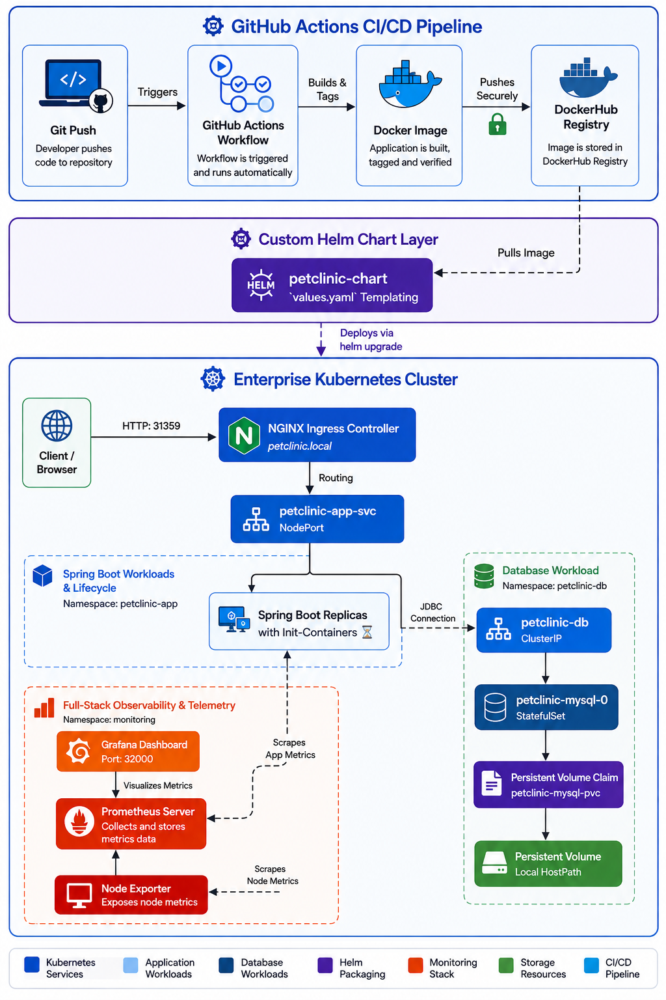
  <br>
  <em><b>Figure 1:</b> System Architecture Diagram </em>
</p>

## 🧰 3. Technology Stack
* **Application:** Java 17, Spring Boot
* **Containerization:** Docker, Multi-Stage Builds (Alpine Linux)
* **Local Orchestration:** Docker Compose
* **Enterprise Orchestration:** Kubernetes (K8s)
* **Infrastructure Packaging:** Helm (Custom Charts & Dynamic `values.yaml` Templating)
* **Database:** MySQL 8.0 (StatefulSets, PV/PVCs for Data Persistence)
* **Networking & Routing:** NGINX Ingress Controller, K8s Services
* **Lifecycle & Security:** K8s Init-Containers (Startup Synchronization), Non-Root Execution, Zero-Trust Network Policies
* **CI/CD Automation:** GitHub Actions
* **Observability & Monitoring:** Prometheus, Grafana, Node Exporter (Deployed via Helm)

## 📂 4. Repository Structure

```text
.
├── .github/                    # GitHub Actions CI/CD Workflows
│   └── workflows/
│       └── ci-cd.yaml          # Automated Build & Push pipeline definition
├── deploy/                     # Infrastructure deployment manifests
│   ├── k8s/                    # Original Kubernetes configuration files
│   │   ├── 01-mysql-storage.yaml    # PV & PVC configurations
│   │   ├── 02-mysql.yaml            # StatefulSet & ClusterIP Service
│   │   ├── 03-app.yaml              # Deployment (with Init-Containers) & Service
│   │   ├── 04-network-policy.yaml   # Zero-Trust Database Isolation
│   │   └── 05-ingress.yaml          # NGINX Ingress Controller setup
│   └── petclinic-chart/        # Custom Helm Chart for dynamic deployments
│       ├── Chart.yaml          # Helm chart metadata
│       ├── values.yaml         # Centralized dynamic configuration (e.g., replicas)
│       └── templates/          # Parameterized Kubernetes manifests
├── docs/                       # Project documentation assets
│   └── images/                 # Execution screenshots and diagrams
│       ├── 2a-compute-resources.png
│       ├── 2b-storage-resources.png
│       ├── 4-ingress-routing.png
│       ├── app-running.png
│       ├── app-running-k8s.png
│       ├── build-process.png
│       ├── containers-healthy.png
│       ├── data-persistence.png
│       ├── docker push.png
│       ├── dockerhub-images.png
│       ├── github-actions-success.png
│       ├── grafana-dashboard.png
│       ├── helm-pods-running.png    # NEW: Replicas and Init-Container stability
│       ├── helm-release.png         # NEW: Helm chart deployment status
│       └── project-diagram.png
├── src/                        # Original Spring Petclinic Source Code
├── Dockerfile                  # Multi-stage, secure container definition
├── docker-compose.yml          # Local orchestration & DB integration
├── pom.xml                     # Maven build configuration
└── .dockerignore               # Context size optimization

```

## 📋 5. Prerequisites
To fully deploy and test this infrastructure, ensure you have the following installed:
* [Git](https://git-scm.com/downloads)
* [Docker Engine](https://docs.docker.com/engine/install/) & [Docker Compose](https://docs.docker.com/compose/install/) (For local testing)
* **A running Kubernetes Cluster** (e.g., `kubeadm`, `minikube`, or cloud-managed like EKS/AKS)
* [`kubectl` CLI](https://kubernetes.io/docs/tasks/tools/) configured to communicate with your cluster
* **NGINX Ingress Controller** installed on your K8s cluster
* [**Helm CLI**](https://helm.sh/docs/intro/install/) (Required for deploying the custom application chart and the Observability stack)

## 🐳 6. Local Execution Guide (Docker Compose)
*Use this method for local development and testing.*

**1. Clone the repository:**
```bash
git clone [https://github.com/YOUR_GITHUB_USERNAME/spring-petclinic.git](https://github.com/YOUR_GITHUB_USERNAME/spring-petclinic.git)
cd spring-petclinic
```
2. Build and run the infrastructure:
```bash
docker-compose up -d --build
```

3. Verify deployment health:
```bash
docker ps
```
Ensure both containers petclinic-web and petclinic-mysql show a (healthy) status.

4. Access the application:
Open your browser and navigate to: http://localhost:8080

5. Stop and clean up:
```bash
docker-compose down -v
```

☸️ 7. Enterprise Deployment Guide (Kubernetes)
Use this method to deploy the highly available, production-ready cluster using our custom Helm chart.

1. Deploy the application via Helm:
Instead of applying multiple YAML files manually, deploy the entire stack (Database, App, Services, Network Policies, and Ingress) with a single command:
```bash
helm install my-petclinic ./deploy/petclinic-chart
```
2. Configure local DNS resolution:
Add the following line to your /etc/hosts file (Linux/Mac) or C:\Windows\System32\drivers\etc\hosts (Windows) to resolve the custom Ingress domain:
# Replace the IP with your actual Kubernetes Node IP
192.168.92.129  petclinic.local

3. Verify cluster health:
```bash
kubectl get pods,svc,ingress
```
Ensure all pods are Running. (Note: The application pods will smoothly wait in Init state until the MySQL database is fully ready).

4. Access the application:
Open your browser and navigate to the assigned Ingress NodePort: http://petclinic.local:31359

**📊 8. Deploy the Observability Stack (Optional):**
Deploy Prometheus and Grafana using the official Helm chart:
```bash
helm repo add prometheus-community [https://prometheus-community.github.io/helm-charts](https://prometheus-community.github.io/helm-charts)
helm repo update
helm install monitoring-stack prometheus-community/kube-prometheus-stack --namespace monitoring --create-namespace
```

📈 9. Access Grafana Dashboards:
Retrieve the auto-generated admin password and port-forward the Grafana service:
```bash
# Extract Grafana Admin Password
kubectl get secret --namespace monitoring monitoring-stack-grafana -o jsonpath="{.data.admin-password}" | base64 --decode ; echo

# Expose Grafana to localhost
kubectl port-forward -n monitoring svc/monitoring-stack-grafana 32000:80
```
Navigate to http://localhost:32000 and log in with username admin and the extracted password.

> 💡 **Developer Note (CI/CD):** If you fork this repository, the GitHub Actions pipeline is ready to use. Simply add `DOCKER_USERNAME` and `DOCKER_PASSWORD` to your repository's GitHub Secrets to enable automated builds and pushes to your own DockerHub registry.

## 🚀 10. Implementation Stages & Verification

### 🐳 Part A: Docker Containerization Phase

#### Stage 1: Multi-Stage Image Build & Optimization
Constructed the customized Spring Boot application image using an optimized multi-stage Dockerfile, significantly reducing the image footprint and securing the build process.
<p align="center">
  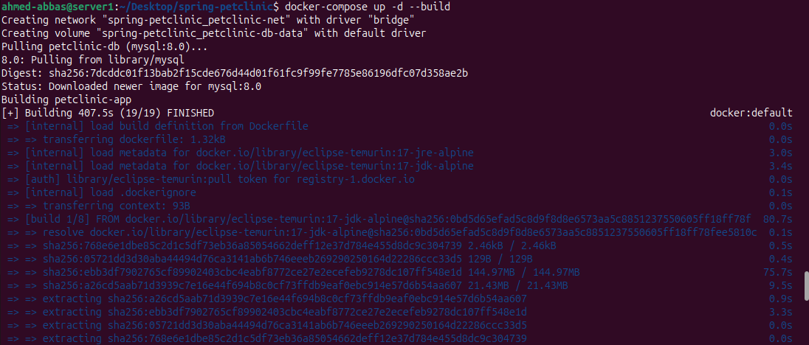
  <br>
  <em><b>Figure 2:</b> Docker Compose build process showcasing layered caching and stage separation.</em>
</p>

#### Stage 2: Local Orchestration & Container Health
Deployed the Spring Boot application and MySQL database using Docker Compose, implementing strict healthchecks to ensure correct startup sequencing and stable runtime.
<p align="center">
  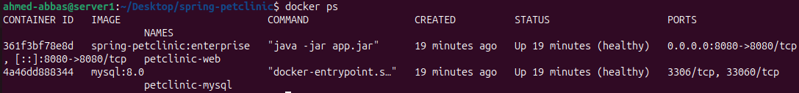
  <br>
  <em><b>Figure 3:</b> Containers operating in an isolated network, both reaching a stable <code>(healthy)</code> state.</em>
</p>

#### Stage 3: Application Routing Verification
Validated the successful exposure of the Spring Petclinic web interface on the designated host port, seamlessly communicating with the internal database network.
<p align="center">
  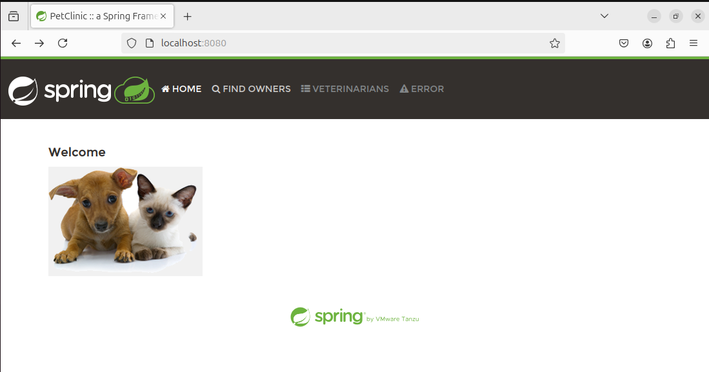
  <br>
  <em><b>Figure 4:</b> The Spring Petclinic application successfully running and accessible via localhost.</em>
</p>

#### Stage 4: Stateful Data Persistence
Verified that the Docker Volumes successfully retained critical application data (e.g., newly added pet owners) across complete container teardowns and restarts.
<p align="center">
  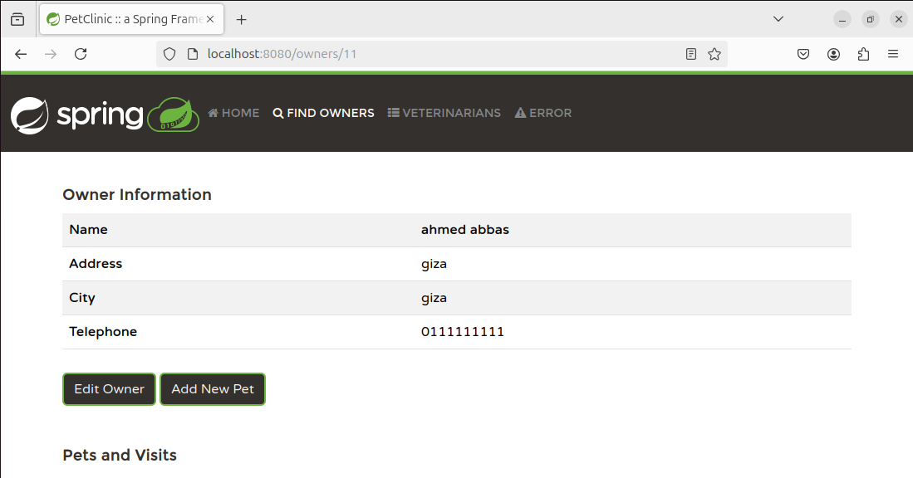
  <br>
  <em><b>Figure 5:</b> Persistent data successfully retrieved from the MySQL volume after a simulated environment restart.</em>
</p>

---

### ☸️ Part B: Kubernetes Enterprise Deployment Phase

#### Stage 1: Private Registry (DockerHub) Integration
Pushed the customized container images to a secure DockerHub repository to be pulled securely by the cluster.
<p align="center">
  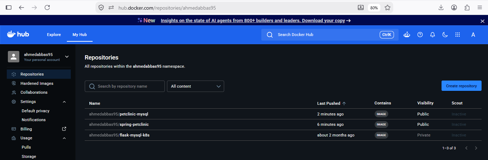
  <br>
  <em><b>Figure 6:</b> DockerHub repository securely storing the application and database images.</em>
</p>

#### Stage 2: Compute Resources Deployment
Deployed the Spring application via Deployments (High Availability with 2 Replicas) and the MySQL database via StatefulSets.
<p align="center">
  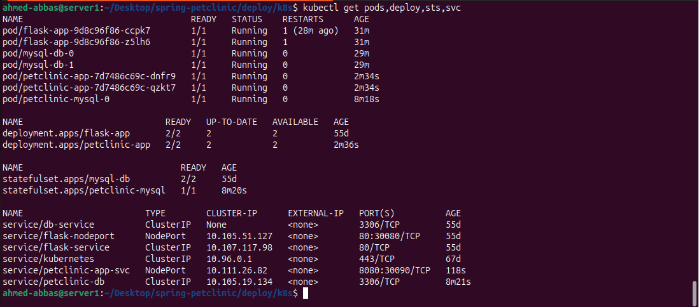
  <br>
  <em><b>Figure 7:</b> Pods, Deployments, and StatefulSets in a stable `Running` state without restart loops.</em>
</p>

#### Stage 3: Dynamic Storage Provisioning
Verified that the Persistent Volume Claims (PVCs) for the database successfully bound to the provisioned Persistent Volumes (PVs).
<p align="center">
  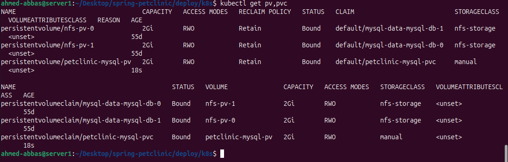
  <br>
  <em><b>Figure 8:</b> PVCs and PVs successfully Bound to isolated host directories.</em>
</p>

#### Stage 4: Network Isolation & Routing Setup
Validated the creation of internal Services, applied strict Network Policies for database isolation, and configured the NGINX Ingress controller for domain routing.
<p align="center">
  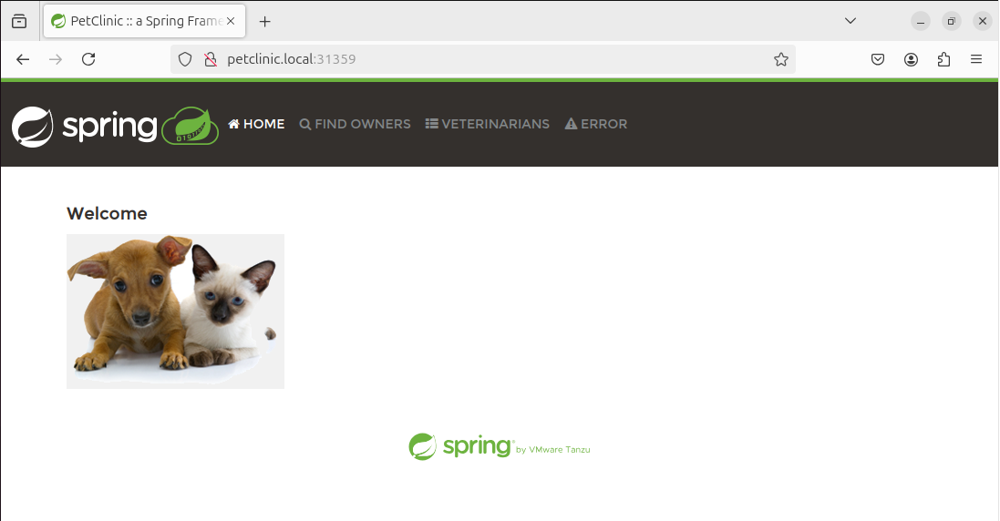
  <br>
  <em><b>Figure 9:</b> Application successfully accessed via NGINX Ingress routing using a custom local domain.</em>
</p>

---
### ⚙️ Part C: CI/CD Automation Phase

#### Stage 1: Automated Build & Push Pipeline
Implemented a fully automated CI/CD pipeline using **GitHub Actions**. Upon code changes, the pipeline securely authenticates with DockerHub via GitHub Secrets, builds the multi-stage image, and pushes it with dynamic version tags (including the Git commit SHA) for reliable version control.
<p align="center">
  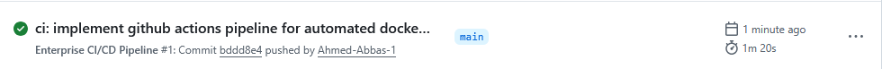
  <br>
  <em><b>Figure 10:</b> Successful execution of the GitHub Actions CI/CD pipeline triggering an automated build and push.</em>
</p>

---

### 📊 Part D: Observability & Monitoring Phase

#### Stage 1: Full-Stack Telemetry Deployment
Deployed a comprehensive monitoring stack using the official `kube-prometheus-stack` Helm chart. The setup includes Prometheus for metric scraping, Node Exporter for hardware metrics, and Grafana for rich data visualization, providing deep insights into cluster and workload health.
<p align="center">
  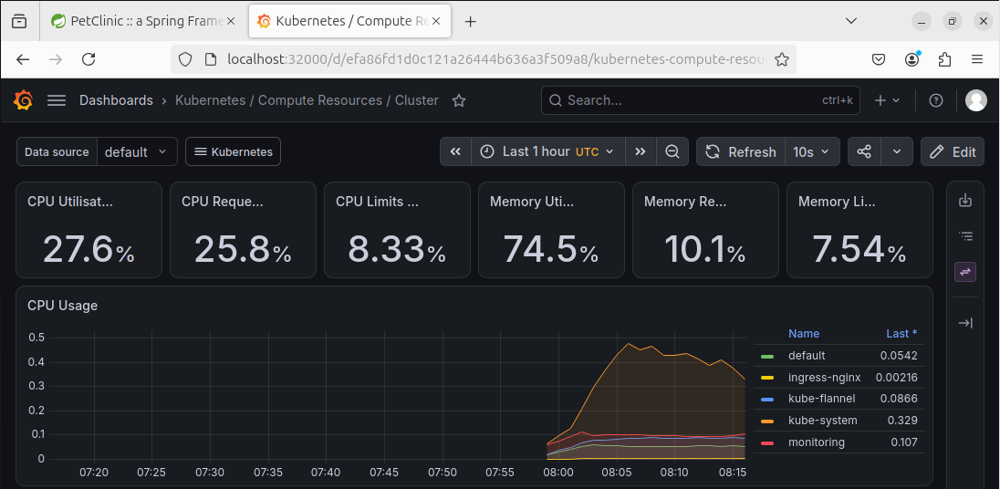
  <br>
  <em><b>Figure 11:</b> Grafana dashboard visualizing real-time compute resources and cluster utilization.</em>
</p>

---

### 📦 Part E: Helm Chart Packaging & Lifecycle Management

#### Stage 1: Dynamic Application Deployment
Packaged the raw Kubernetes YAML manifests into a **Custom Helm Chart** (`petclinic-chart`). This allows for single-command deployments and dynamic configuration management (e.g., scaling replicas dynamically via `values.yaml` templating) rather than hardcoding values in static files.
<p align="center">
  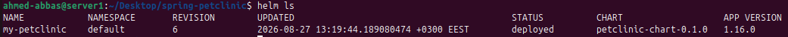
  <br>
  <em><b>Figure 12:</b> Successful Helm chart deployment creating a managed release for the Petclinic infrastructure.</em>
</p>

#### Stage 2: Startup Synchronization (Init-Containers)
Resolved the classic `CrashLoopBackOff` race condition by implementing Kubernetes **Init-Containers**. The application pods now intelligently wait for the MySQL database to become fully operational on port 3306 before initializing, ensuring a smooth, crash-free startup sequence across all dynamically scaled replicas.
<p align="center">
  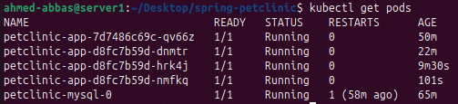
  <br>
  <em><b>Figure 13:</b> Application and Database pods running flawlessly, stabilized by Init-Containers and dynamically scaled to 3 replicas.</em>
</p>

## ⚠️ 11. Challenges Encountered & Solutions
* **Challenge:** Large image size and slow build times during initial containerization.
  * **Solution:** Implemented **Multi-Stage Builds** using Alpine Linux, leveraging layer caching to download dependencies only once and reducing the final footprint drastically.
* **Challenge:** Guaranteeing database data persistence across ephemeral Kubernetes Pod restarts.
  * **Solution:** Transitioned from Deployments to **StatefulSets** for the MySQL database and implemented **Persistent Volumes (PV) & PVCs** mapped to isolated host directories.
* **Challenge:** Securely routing external traffic to the application while completely isolating the database from public access.
  * **Solution:** Utilized an **NGINX Ingress Controller** for clean domain-based routing (`petclinic.local`) and applied strict **Zero-Trust Network Policies** that restrict database access exclusively to the application pods.
* **Challenge:** Application pods entering a `CrashLoopBackOff` state due to a race condition where they initialize before the database is fully ready.
  * **Solution:** Implemented Kubernetes **Init-Containers** within the Custom Helm Chart to actively poll the database port, ensuring the main application container only boots after a successful connection to MySQL is established.

## 🔭 12. Future Enhancements
- [x] Migrate local orchestration to an **Enterprise Kubernetes Cluster**.
- [x] Establish automated CI/CD pipelines via **GitHub Actions**.
- [x] Integrate a full observability and telemetry stack (**Prometheus & Grafana** via Helm).
- [x] Package custom Kubernetes manifests using **Helm Charts** for dynamic deployments.
- [ ] Implement Infrastructure as Code (IaC) provisioning pipelines with **Terraform & Ansible**.
## 📬 13. Contact & Connect

<div align="center">
  <h3>🏗️ Architected & Deployed by</h3>
  <h2>Ahmed Mohamed Abbas Bahij</h2>
  <p><b>Cloud Infrastructure & DevOps Engineer</b></p>
  
  <a href="https://www.linkedin.com/in/ahmedabbas99" target="_blank">
    
  </a>
</div>
<hr>
